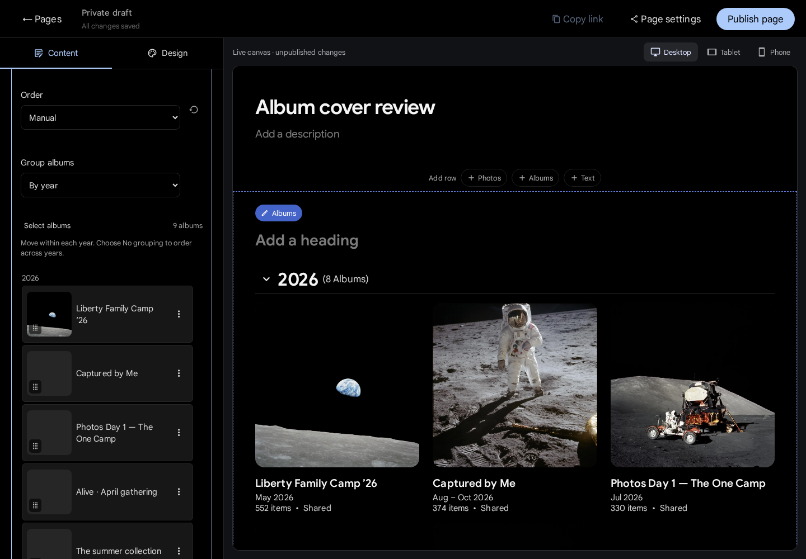
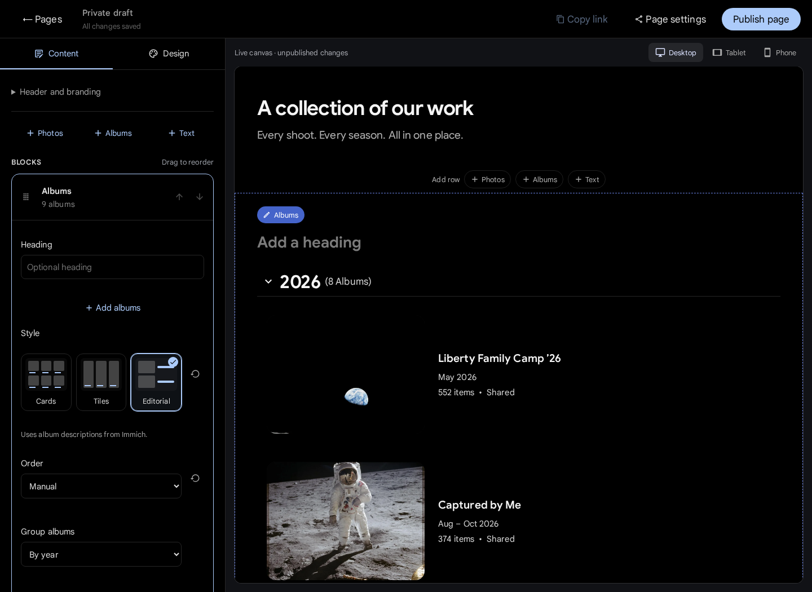

# ImmichPager

**One link. Every shoot.**

[](https://gitlab.com/wispd/ImmichPager/-/pipelines)
[](LICENSE)
[](docs/deployment.md)

Persistent, customizable client pages for [Immich](https://immich.app). Give returning photography clients one place for all the work they've commissioned. Arrange photos, albums, and text on a live canvas, add your branding, and keep adding shoots to the same URL:

```text
https://photos.example.com/page/acme
```

An independent, self-hosted community companion. Photos stay in Immich; clients browse albums and open photos directly on the page. No client account or global API key required.

[Live showcase](https://im.devonlabs.space/page/clients-immichpager-showcase) · [Docker setup](#quick-start) · [Development](#development) · [Documentation](#documentation) · [Report a bug](https://gitlab.com/wispd/ImmichPager/-/issues/new)

## See it in use

Explore the [maintainer's public showcase](https://im.devonlabs.space/page/clients-immichpager-showcase): a branded concert photo row followed by client albums for **GoBound Gym**, **India VKC Retail**, **Goated Sound Mixer**, and **Yeet Fleet**.

<p align="center">
  <a href="https://im.devonlabs.space/page/clients-immichpager-showcase">
    
    
  </a>
</p>

Open an album to browse its photos without leaving the page. Open a photo for the shared viewer, with keyboard navigation, fullscreen, and optional slideshow and downloads.

<details>
<summary>See an expanded album and the on-page photo viewer</summary>


</details>

These are actual browser captures of the public showcase supplied by the maintainer for README examples. Showcase photography remains the property of its respective owners. The captures are hosted as GitLab project uploads; the repository's development fixtures use attributed NASA photographs.

<details>
<summary>See the responsive contributor demo</summary>

<p align="center">
  
  
</p>

Screenshots use attributed [NASA Apollo photographs](fixtures/photos/README.md) and illustrative album data, not a live client library.

</details>

## Features

- **Persistent client links:** one `/page/custom-slug` URL across months of work.
- **Immich-style albums:** square covers, dates, item counts, collapsible years, and manual or chronological ordering.
- **Per-page branding:** choose a logo/banner from Immich Photos, drop an image, or upload; adjust crop, alignment, banner and logo size, title and description sizes, header spacing, and colors.
- **Live page composer:** add, reorder, duplicate, and remove Photos, Albums, and rich Text rows on the finished page.
- **On-page photo viewer:** expand albums, navigate photos with keyboard or swipe, play slideshows, and download photos or ZIPs when permitted.
- **Private autosaved drafts:** edit freely without changing the live page; publish updates explicitly.
- **Publication review:** see albums being added or removed and page appearance changes before updating the live page.
- **Easy sharing:** Copy link on each published page, with Page settings for access, download permissions, and local PNG/SVG QR exports.
- **Password protection:** optional page password/PIN applied to dedicated Immich album shares too. The page unlock also authorizes its photos.
- **Inside Immich:** a Pages sidebar entry and existing session authentication; each photographer manages their own pages. About shows the installed Pager version, with administrator notices for newer stable releases.
- **Dedicated share links:** existing shares remain untouched. Interrupted operations are tracked and can be retried.
- **Docker companion:** published amd64/arm64 images, one container and SQLite volume, with no changes to Immich's image or database.
- **Contributor-friendly:** typed boundaries, local Immich fixtures, browser tests, CI, issue forms, and architecture documentation.

<details>
<summary>See the photographer's editor</summary>

Open **Pages** in Immich's left sidebar to create and manage client pages.



Edit the title and description on the live canvas. Use **Content** to add Albums, Photos, or Text rows and choose branding from Immich or uploaded files. **Design** controls appearance; **Page settings**, beside Publish, opens sharing options for the persistent URL, downloads, and password protection. Changes autosave privately. Choose **Publish page** or **Update live page** when ready.





</details>

## Compose and customize

The Content and Design inspectors sit beside one persistent live canvas. Desktop, tablet, and phone controls resize that canvas; editing is already a preview of the finished page.

- **Albums rows:** Cards, Tiles, or Editorial layouts, year grouping, and manual or chronological ordering. Cover previews and multi-select dragging make large selections easier to arrange.
- **Photos rows:** Justified, Masonry, Square, Large, or Carousel layouts, with captions and ordering for your selected photos.
- **Text rows:** headings, paragraphs, bold, italic, links, lists, and alignment.
- **Header and branding:** Classic, Centered, or Editorial presets; below-banner or over-banner composition; direct sizing, crop, and logo controls.
- **Design tools:** bundled fonts, typography, colors, spacing, scoped CSS with [12 ready-to-use examples](docs/css-examples.md), and individual or full presentation resets. Resets retain authored content, selected media, and access settings.
- **Reusable appearance:** duplicate a design, transfer a version 4 appearance file, or import [DTCG design tokens](docs/design-tokens.md) after reviewing the import summary.
- **Complete client themes:** five original layouts and [12 photography designs](docs/photography-themes.md) for weddings, portraiture, wildlife, and general portfolios; preview before applying, reuse personal designs, or adapt shadcn/Tweakcn and daisyUI theme CSS. [Theme guide](docs/themes.md).

All edits autosave privately until you choose **Publish page** or **Update live page**. Page settings beside Publish holds the client URL, download permissions, password protection, and page-management actions. See the [customization guide](docs/customization.md).

## Quick start

Requires Docker Compose v2, an existing Immich installation, and control of its HTTPS reverse proxy.

```sh
git clone --branch v0.4.0 --depth 1 https://gitlab.com/wispd/ImmichPager.git
cd ImmichPager
cp .env.example .env
```

Set `IMMICH_URL` to the **internal** Immich root, such as `http://immich-server:2283`, and `ORIGIN` to its public HTTPS origin. Set `IMMICH_NETWORK` if your existing Docker network has another name, and pin `PAGER_TAG=0.4.0` in `.env`.

```sh
docker compose pull immichpager
docker compose up -d --no-build
```

The registry image supports Linux amd64 and arm64. To build from the checked-out source instead, use `docker compose up -d --build`.

Point the existing HTTPS proxy at Pager's default `127.0.0.1:3102` listener. Sign in to Immich and choose **Pages → Create page**. Add albums, choose branding, compose the live canvas, and publish. Later edits autosave as a working draft until you update the live page.

All Pager routes and assets use `/page/`; native Immich `/api/`, `/s/`, and `/share/` routes continue to the upstream. You can chain Pager in front of Immichinko or keep an Immicull custom server. See [deployment and configuration](docs/deployment.md) for exact setup, image tags, proxy trust, backups, and rollback.

The [v0.4.0 release](https://gitlab.com/wispd/ImmichPager/-/releases/v0.4.0) includes tagged source and a compiled runtime build context with SHA-256 checksums. Historical v0.1.0 ARM64 packages remain available through the [deployment guide](docs/deployment.md#prebuilt-arm64-package).

## Compatibility and current status

Initial source review targets **Immich v3.3.1**, with an ARM64 runtime deployment and public HTTP smoke checks verified on **v3.3.3** alongside Immichinko and a RAW/JPEG companion. Authenticated editing and publishing tests use an isolated fixture; the signed-in live workflow remains to be checked. This is an early implementation, not a claim of compatibility with every Immich release.

The v0.4.0 feature set passed 219 unit tests, 83 Chromium scenarios, type checking, lint, formatting, audit, production build, and hosted Docker smoke checks. Published amd64/arm64 image digests and release labels were verified, and the downloaded ARM64 image passed native health/readiness checks. Source, releases, and reviews live on [GitLab](https://gitlab.com/wispd/ImmichPager); see the [migration record](docs/gitlab-migration.md). Historical v0.1.0 downloads remain on GitHub.

The sidebar bridge is a maintained DOM integration rather than an official Immich plugin API. Use one Pager container per database. When upstream revocation fails, the overview is hidden; existing native links remain subject to Immich until the owner finishes synchronization. See [validation notes](docs/validation.md).

**Upgrading an existing installation:** the current development branch migrates Pager to schema version 4 (the published 0.4.0 release uses schema 3). Back up the complete stopped Pager volume first. Rolling back to an older image requires restoring that backup too. See [upgrade and rollback](docs/deployment.md#schema-upgrades).

## Development

Built with SvelteKit, Svelte, TypeScript, Immich UI, and SQLite. No real library is needed for development.

```sh
nvm install
nvm use
corepack enable
corepack prepare pnpm@11.28.5 --activate
pnpm install --frozen-lockfile
pnpm dev:demo
```

Open `http://127.0.0.1:3000/page/acme` for the sample page. Visit `/dev-login/alice` on that local demo to open the editor with a fixture account. If the ports are occupied, use `DEMO_PORT=3300 pnpm dev:demo`.

To run the fixture demo in Docker without installing Node or connecting to Immich, use `docker compose -f compose.dev.yaml up --build`. See [development setup](docs/development.md#fixture-only-docker-compose-demo) for port selection, reset, and validation steps.

```sh
pnpm check
pnpm lint
pnpm test
pnpm build
pnpm exec playwright install chromium
pnpm test:e2e
pnpm format:check
```

See [development setup](docs/development.md) for all commands, browser requirements, port configuration, and fixture behavior.

## Documentation

| Guide                                              | Contents                                                         |
| -------------------------------------------------- | ---------------------------------------------------------------- |
| [Deployment](docs/deployment.md)                   | Docker, environment variables, proxy chaining, backups, rollback |
| [Development](docs/development.md)                 | Fresh-clone setup, fixtures, tests, contributor workflow         |
| [Architecture](docs/architecture.md)               | Module boundaries, authentication, sharing recovery, storage     |
| [GitLab distribution](docs/gitlab-distribution.md) | CI, protected release publishing, and migration steps            |
| [API](docs/api.md)                                 | Routes, typed inputs, errors, retry behavior                     |
| [Validation](docs/validation.md)                   | Tested behavior, visual checks, compatibility limits             |
| [Releases](docs/releases.md)                       | Versions, image publishing, and release checks                   |

## Contributing

Bug reports, fixes, documentation, and accessibility improvements are welcome. Read [CONTRIBUTING.md](CONTRIBUTING.md), [design guidance](DESIGN.md), and the [code of conduct](CODE_OF_CONDUCT.md). Use the issue forms and include tests for behavior changes.

Report vulnerabilities privately according to [SECURITY.md](SECURITY.md). Never include client photos, credentials, or real private share URLs in reports.

## Roadmap

See the [ImmichPager roadmap](TODO.md) for released capabilities and deferred product decisions. The [merge request history](tasks/review.md) records the reviewed work behind those releases.

## Related projects and acknowledgments

- [Immich](https://github.com/immich-app/immich): photo storage, shared albums, UI components, and the album layout reference.
- [Immichinko](https://github.com/wispdevon/Immichinko): daily photo rediscovery and companion gateway patterns.
- [Best-README-Template](https://github.com/othneildrew/Best-README-Template): inspiration for the documentation structure.

ImmichPager is not affiliated with the Immich team or NASA.

## License

[AGPL-3.0-only](LICENSE). See [NOTICE](NOTICE) for upstream attribution and fixture-image credits. Contributions use the same license.
