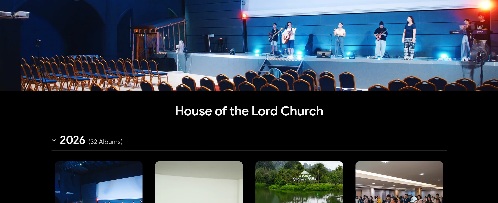
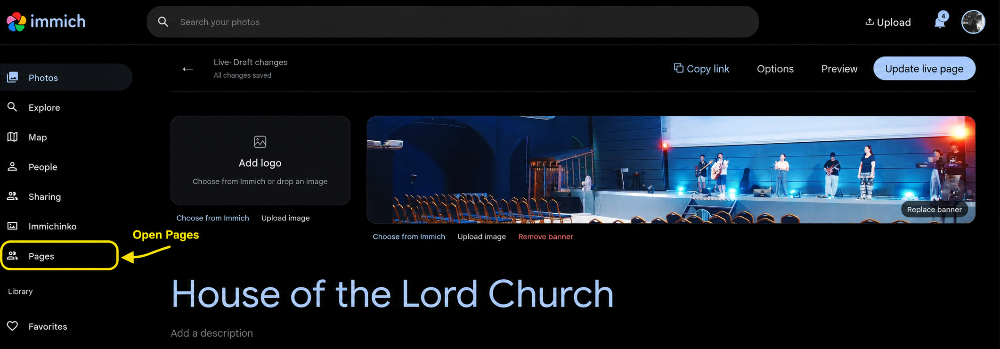
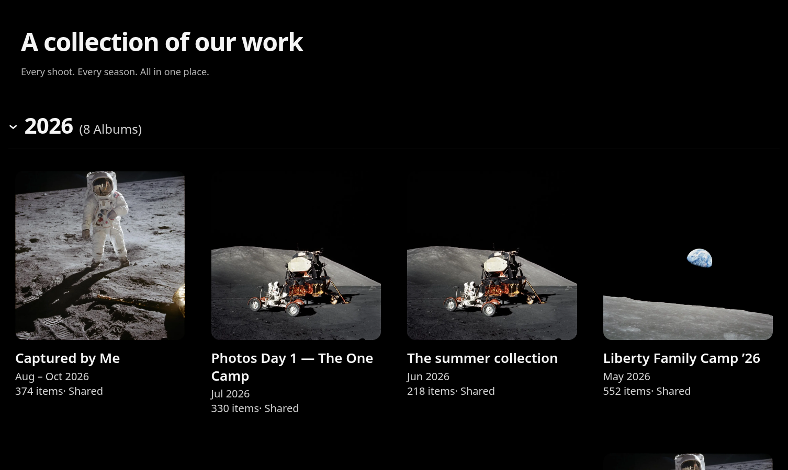
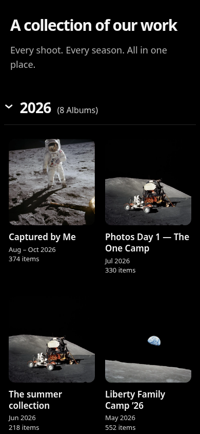
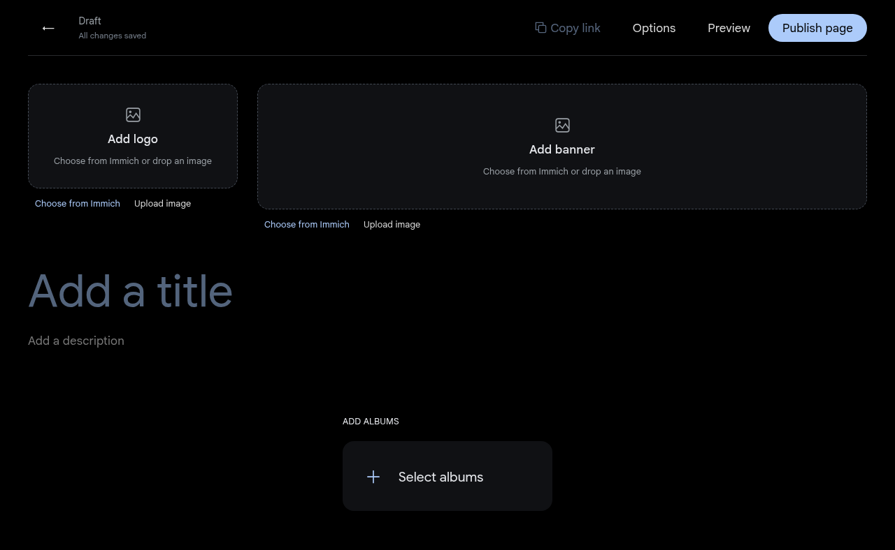
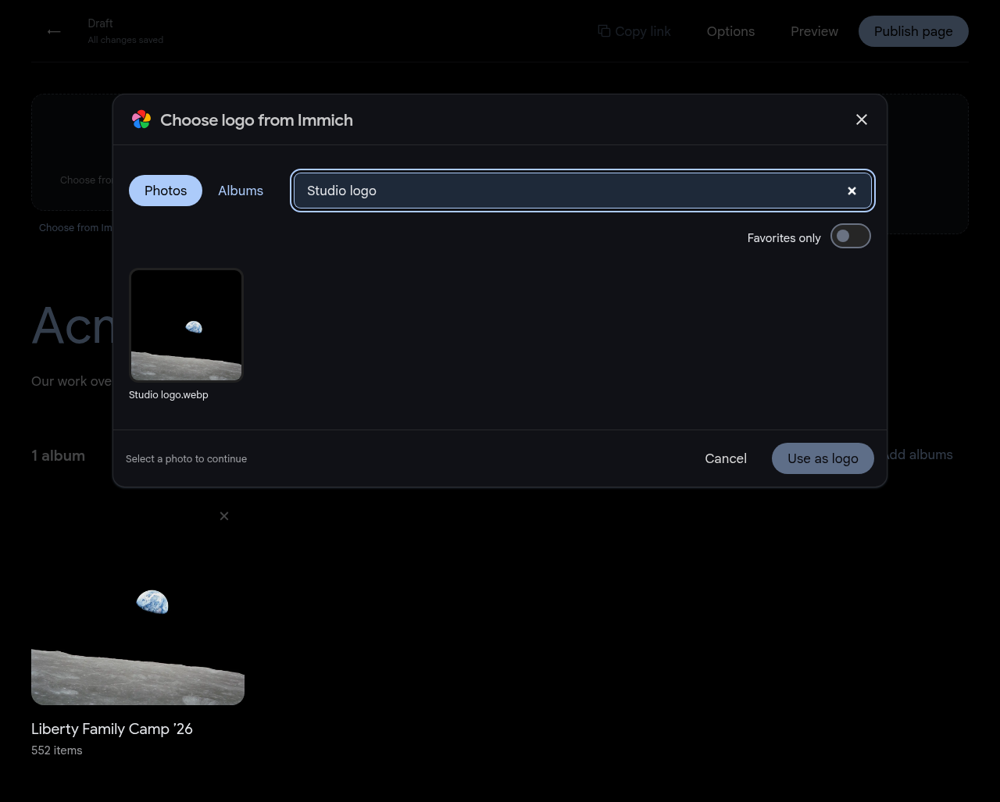
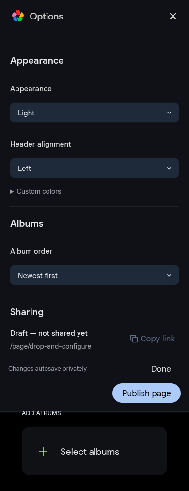
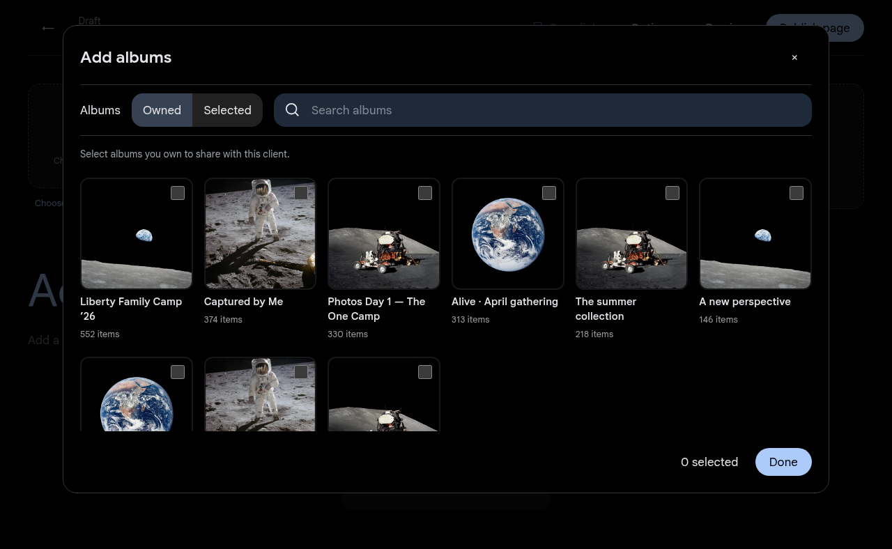

# ImmichPager

**One link. Every shoot.**

[](https://github.com/wispdevon/ImmichPager/actions/workflows/ci.yml)
[](LICENSE)
[](docs/deployment.md)

Persistent, customizable client album pages for [Immich](https://immich.app). Give returning photography clients one place for all the work they've commissioned. Select existing albums, customize the header, and keep adding shoots to the same URL:

```text
https://photos.example.com/page/acme
```

An independent, self-hosted community companion. Photos stay in Immich; albums open in its native shared viewer. No client account or global API key required.

[Docker setup](#quick-start) · [Development](#development) · [Documentation](#documentation) · [Report a bug](https://github.com/wispdevon/ImmichPager/issues/new/choose)

## A familiar album overview



Open **Pages** in Immich's left sidebar to create and manage client pages:



These real-use screenshots were supplied by the project maintainer for publication.

<details>
<summary>See the responsive contributor demo</summary>

<p align="center">
  
  
</p>

Screenshots use attributed [NASA Apollo photographs](fixtures/photos/README.md) and illustrative album data, not a live client library.

</details>

## Features

- **Persistent client links:** one `/page/custom-slug` URL across months of work.
- **Immich-style albums:** square covers, dates, item counts, collapsible years, and manual or chronological ordering.
- **Per-page branding:** choose a logo/banner from Immich Photos, drop an image, or upload; adjust crop, alignment, and colors.
- **Private autosaved drafts:** edit freely without changing the live page; publish updates explicitly.
- **Easy sharing:** Copy link on each published page, with an Immich-style Options panel for configuration.
- **Password protection:** optional page password/PIN applied to dedicated Immich album shares too. The native viewer may prompt again.
- **Inside Immich:** a Pages sidebar entry and existing session authentication; each photographer manages their own pages.
- **Dedicated share links:** existing shares remain untouched. Interrupted operations are tracked and can be retried.
- **Docker companion:** one container and SQLite volume; amd64/arm64 image workflow, no changes to Immich's image or database.
- **Contributor-friendly:** typed boundaries, local Immich fixtures, browser tests, CI, issue forms, and architecture documentation.

<details>
<summary>See the photographer's editor</summary>



Start with **Add a title**, **Add a description**, and **Select albums**. Branding areas accept dropped files or **Choose from Immich**. Changes autosave privately. Use **Options** for appearance, ordering, the persistent URL, and password protection; choose **Publish page** or **Update live page** when ready.







</details>

## Quick start

Requires Docker Compose v2, an existing Immich installation, and control of its HTTPS reverse proxy.

```sh
git clone --branch v0.1.0 --depth 1 https://github.com/wispdevon/ImmichPager.git
cd ImmichPager
cp .env.example .env
```

Set `IMMICH_URL` to the **internal** Immich root, such as `http://immich-server:2283`, and `ORIGIN` to its public HTTPS origin. Set `IMMICH_NETWORK` if your existing Docker network has another name.

```sh
docker compose up -d --build
```

Point the existing HTTPS proxy at Pager's default `127.0.0.1:3102` listener. Sign in to Immich and choose **Pages → Create page**. Add albums, choose branding, preview, and publish. Later edits autosave as a working draft until you update the live page.

All Pager routes and assets use `/page/`; native Immich `/api/`, `/s/`, and `/share/` routes continue to the upstream. You can chain Pager in front of Immichinko or keep an Immicull custom server. See [deployment and configuration](docs/deployment.md) for exact setup, image tags, proxy trust, backups, and rollback.

The [v0.1.0 release](https://github.com/wispdevon/ImmichPager/releases/tag/v0.1.0) also includes a prebuilt ARM64 Docker image, a compiled runtime build context, source, and SHA-256 checksums. See [importing the ARM64 package](docs/deployment.md#prebuilt-arm64-package) to install without a frontend build.

## Compatibility and current status

Initial source review targets **Immich v3.3.1**, with an ARM64 runtime deployment and public HTTP smoke checks verified on **v3.3.3** alongside Immichinko and a RAW/JPEG companion. Authenticated editing and publishing tests use an isolated fixture; the signed-in live workflow remains to be checked. This is an early implementation, not a claim of compatibility with every Immich release.

The stable release was verified locally with 55 domain tests and 7 browser tests. GitHub Actions is currently disabled for the maintainer account, and GHCR publication is pending. The downloadable ARM64 Docker image is available from the release; source builds support amd64 and arm64. The committed workflows can publish registry images when Actions is available.

The sidebar bridge is a maintained DOM integration rather than an official Immich plugin API. Use one Pager container per database. When upstream revocation fails, the overview is hidden; existing native links remain subject to Immich until the owner finishes synchronization. See [validation notes](docs/validation.md).

**Upgrading an existing installation:** this update migrates Pager to schema version 2. Back up the complete stopped Pager volume first. Rolling back to an older image requires restoring that backup too. See [upgrade and rollback](docs/deployment.md#schema-upgrades).

## Development

Built with SvelteKit, Svelte, TypeScript, Immich UI, and SQLite. No real library is needed for development.

```sh
nvm install
nvm use
corepack enable
corepack prepare pnpm@11.28.5 --activate
pnpm install --frozen-lockfile
pnpm dev:demo
```

Open `http://127.0.0.1:3000/page/acme` for the sample page. Visit `/dev-login/alice` on that local demo to open the editor with a fixture account. If the ports are occupied, use `DEMO_PORT=3300 pnpm dev:demo`.

```sh
pnpm check
pnpm lint
pnpm test
pnpm build
pnpm exec playwright install chromium
pnpm test:e2e
pnpm format:check
```

See [development setup](docs/development.md) for all commands, browser requirements, port configuration, and fixture behavior.

## Documentation

| Guide                                | Contents                                                         |
| ------------------------------------ | ---------------------------------------------------------------- |
| [Deployment](docs/deployment.md)     | Docker, environment variables, proxy chaining, backups, rollback |
| [Development](docs/development.md)   | Fresh-clone setup, fixtures, tests, contributor workflow         |
| [Architecture](docs/architecture.md) | Module boundaries, authentication, sharing recovery, storage     |
| [API](docs/api.md)                   | Routes, typed inputs, errors, retry behavior                     |
| [Validation](docs/validation.md)     | Tested behavior, visual checks, compatibility limits             |
| [Releases](docs/releases.md)         | Versions, image publishing, and release checks                   |

## Contributing

Bug reports, fixes, documentation, and accessibility improvements are welcome. Read [CONTRIBUTING.md](CONTRIBUTING.md), [design guidance](DESIGN.md), and the [code of conduct](CODE_OF_CONDUCT.md). Use the issue forms and include tests for behavior changes.

Report vulnerabilities privately according to [SECURITY.md](SECURITY.md). Never include client photos, credentials, or real private share URLs in reports.

## Roadmap

- [x] Persistent pages, branding, themes, and year-grouped albums.
- [x] Multi-photographer ownership and dedicated native sharing.
- [x] Passwords, recovery, Docker packaging, and a local contributor demo.
- [ ] Record live compatibility against supported Immich releases.
- [ ] Expand automated compatibility fixtures as Immich evolves.

Automatic album naming rules, client accounts, and a replacement photo viewer are outside the initial scope.

## Related projects and acknowledgments

- [Immich](https://github.com/immich-app/immich): photo storage, shared albums, UI components, and the album layout reference.
- [Immichinko](https://github.com/wispdevon/Immichinko): daily photo rediscovery and companion gateway patterns.
- [Best-README-Template](https://github.com/othneildrew/Best-README-Template): inspiration for the documentation structure.

ImmichPager is not affiliated with the Immich team or NASA.

## License

[AGPL-3.0-only](LICENSE). See [NOTICE](NOTICE) for upstream attribution and fixture-image credits. Contributions use the same license.
