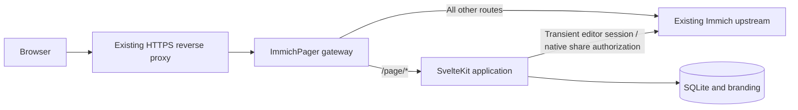

# Architecture

## Request flow

One Node process serves the application and proxies Immich. Immich's database, image, originals, and configuration are not modified. Only Pager-owned shared links are created, updated, or deleted through Immich's HTTP API.

## Code boundaries

- `src/lib/contracts.ts`: validated inputs, typed domain records, public/editor DTOs.
- `src/lib/server`: SQLite persistence, Immich HTTP client, authorization, page lifecycle, public gallery assembly.
- `src/lib/components`: reusable public gallery presentation.
- `src/routes`: thin HTTP adapters and editor/client screens, all mounted under `/page`.
- `server`: same-origin gateway and credential-free sidebar bridge.
- `fixtures`, `tests`, `e2e`: local Immich fixture, domain/integration tests, production-browser tests.

## Authentication and ownership

The editor forwards the current browser's Immich session to `GET /api/users/me`. Pager then verifies the returned user ID against each stored page's owner. Browser-supplied owner IDs are never accepted. Only owned albums can be selected. The Immich client normalizes v3 ownership from `albumUsers[0].user.id` (the upstream DTO guarantees the owner is first), with `ownerId` retained as a legacy fallback. Shared-with-me collaborators never become owners. HTTP fixtures use the v3 DTO so client/schema drift cannot silently empty the picker. No global API key or persistent editor credentials are needed.

Public page passwords use salted scrypt hashes. Unlocking obtains native shared-link authorization using the submitted password and retains only the resulting cookie capabilities in a 12-hour server-side session. The browser receives an opaque, HttpOnly, SameSite cookie scoped to `/page`. Passwords are never persisted by Pager; Immich manages the native links according to its own implementation.

Metadata and all image routes independently enforce publication and session checks. Owner previews require a freshly verified Immich session. Published revisions invalidate client sessions after publication changes; autosaving a working draft does not touch the live revision or sessions. Native album links are independent of the overview: Immich can prompt again, and previously authorized native sessions follow Immich's lifecycle.

## Durable sharing operations

DraftService owns working-copy persistence and revision checks. Draft saves do not publish albums or update live settings/media. Incomplete titles and URLs can be saved privately; publication applies the strict page schema. Password values are never part of the autosave document.

Publication flushes the editor queue, checks the expected draft revision and album ownership, and stages a durable intent before changing native links. After synchronization, published settings, branding copies, and the matching draft marker commit in one SQLite transaction. Header/order-only updates retain existing native links and do not need the album password. Publication review and publishing share the same synchronization predicate: membership, password actions, and download-permission changes require native synchronization. `allowDownload` is additive JSON with a compatibility default of `true`; it applies to new and retained Pager-owned shares only. Design duplication and appearance transfer exclude access policy.

Publishing creates one dedicated native link per unique page–album association with deterministic slugs `pager-{page UUID}-{album UUID}`, reused across blocks. Each Photos block gets an exact-selection individual share named `pager-{page UUID}-photos-{block ID}`. The client stays on `/page/{client slug}` while Pager authorizes metadata, images, and downloads through those server-side capabilities. Retained direct native links still follow Immich’s lifecycle.

Before changing links, persist `syncing` and the operation intent. Persist each successful create or delete. On retry, list the owner's native shares and adopt matching deterministic slugs, recovering creates whose response was lost. Missing links can be recreated. Native updates always include the slug because the reviewed Immich service otherwise clears it.

Errors and interrupted operations hide the public overview. Restart recovery converts `syncing` to `error`; the owner can retry publishing, unpublishing, or deletion with their current session. Removing protected albums or changing passwords hides the overview until synchronization succeeds. Already issued direct native links may remain usable until revocation reaches Immich; Pager does not claim to revoke an upstream link while Immich is offline.

Use exactly one Pager process/container per database. A process-local mutation lock prevents concurrent operations on the same page. SQLite WAL and foreign keys protect local consistency. Scaling multiple replicas against the same volume is unsupported.

## Storage and migrations

SQLite schema version 4 is initialized and migrated transactionally in `Store`. Version 3 normalizes legacy pages/drafts into one Albums block and adds a separate `photo_shares` table while retaining existing album links and client sessions. Version 4 adds an owner-indexed personal theme library without rewriting existing records. Version 2 adds independent `drafts` and `draft_branding` tables; existing `pages` and `branding` retain the live version. Migration copies existing pages/media into working copies and preserves native shares, password hashes, and client sessions. Brand-new drafts need no published row until publication. Tables hold pages, dedicated links, expiring public sessions, branding images, and password-attempt buckets. Forward migrations must use `PRAGMA user_version` and remain covered by tests. A newer database is refused by an older application. Future migrations must be added sequentially; do not modify the meaning of an existing version.

Branding uploads accept JPEG, PNG, and WebP up to 5 MB / 32 megapixels and are decoded, rotated, resized, stripped of metadata, and re-encoded to WebP. The photo picker searches owned images using Immich v3 metadata filters, with cursor pagination, filenames, album scope, and favorites. Results expose minimal metadata; each thumbnail and branding selection rechecks ownership and excludes locked, trashed, offline, or non-image assets. PNG/WebP selections use bounded originals to retain transparency; other images use previews. Only same-upstream, same-asset media redirects are followed. Selected branding becomes a processed local copy, so removal of the Immich original does not break it. Photo covers are streamed from Immich. Protect the data volume: it contains share capabilities and session authorization, even though it contains no photo originals.

## Integration boundary

The gateway injects a small external sidebar script into eligible uncompressed Immich HTML. The bridge clones the Sharing entry and mounts the editor in a same-origin iframe. If the main layout is unavailable, the link falls back to the standalone editor. This is a maintained DOM integration, not an official Immich plugin API. Native API requests, share pages, binary responses, uploads, and WebSocket upgrades remain upstream.

The management screen inherits the host's exclusive `light` or `dark` root class while embedded. In standalone mode, it reads only Immich's `immich-ui-theme` preference and falls back to the system color scheme. A self-hosted script applies the first theme before paint; the editor then follows same-origin root-class changes, preference storage events, and system changes. The bridge is limited to `/page/manage`, excluding nested Gallery previews, and does not read credentials or use `postMessage`. Editor surfaces use Immich UI palette tokens; public Gallery theme and custom CSS stay scoped to each page. This mirrors Immich 3.3.3's [theme initializer](https://github.com/immich-app/immich/blob/v3.3.3/web/src/app.html#L515-L536) and its separate [user appearance preference](https://github.com/immich-app/immich/blob/v3.3.3/web/src/routes/%28user%29/user-settings/AppSettings.svelte#L534-L553).

Initial source review targets Immich v3.3.1. See [validation](validation.md) for the distinction between fixture verification and live compatibility.

## Gallery customization (dev)

Header composition presets, banner and logo size, typography, spacing, and custom CSS are additive per-page JSON settings with defaults applied on read, so no schema upgrade is needed. They remain in the working copy until explicit publication. The shared CSS Tree compiler validates allowed syntax, guards each selector's target with the page's gallery boundary, and blocks resource loading. Invalid CSS is preserved privately, omitted from preview, and rejected by publication before changing live settings or shares. A separate layout/paint containment wrapper protects editor controls from positioned gallery content. The renderer escapes HTML-opening characters in compiled CSS before serializing the stylesheet. Documented selectors and theme variables form the supported styling interface; see [customization](customization.md).

## Per-page controls and portable themes

`clientUi` and `galleryStyle` are validated additive JSON settings in drafts, published records, and gallery DTOs. Reading legacy JSON fills compatibility defaults; creating a page disables browsing controls by default. Duplication copies these settings, and publication review identifies visibility and style changes before they reach clients. No SQLite schema migration is needed.

The shared renderer emits gallery-scoped `--pager-*` defaults with zero specificity so authored CSS can override visual controls. The inspector sends validated local working state to the owner-only canvas iframe immediately. Autosave acknowledgments update persisted membership without reloading the iframe or disturbing focus. Client CSS stays isolated from native inspector controls, and compiler guards exclude canvas editor controls. Failed saves retain local working fields and show retry feedback.

Appearance-file version 4 carries visibility, visual settings, banner height, CSS, and a complete theme snapshot. Versions 1–3 import through Classic and retain compatibility behavior for settings they cannot express. Content and resource identifiers are excluded. DTCG 2025.10 token files carry only recognized style values, resolve local aliases without network access, and present recognized/unsupported tokens before applying. Imports remain bounded at 96 KiB, and custom CSS retains its 20,000-character limit and resource-loading restrictions.

## Page access and publication review

Draft inputs and owner editor responses include `allowDownload: boolean` (default `true`, including legacy records). This setting remains private until publication; permission changes synchronize every retained and new dedicated share. It is excluded from appearance and design-token exports, and duplicated designs start with downloads enabled.

The publication-review GET endpoint accepts `passwordMode=keep|set|remove` alongside `expectedDraftRevision`, without a password value. Its response adds `passwordAction` (`keep`, `set`, `change`, or `remove`), `requiresCurrentPassword`, and `downloadChange` (`null` or `{ before: boolean | null, after: boolean }`). The synchronization predicate is shared with publication. Passwords are submitted only in the explicit publish/retry body, never autosaved. Both draft and published revision checks still protect a reviewed publication.

### Version awareness

`GET /page/api/version` requires an Immich session. It returns `installedVersion`,
`installedReleaseUrl`, `latestVersion`, `latestReleaseUrl`, `updateAvailable`,
`checkedAt`, and `status` (`disabled`, `current`, `available`, `unavailable`, or
`stale`), plus the authenticated `userId` and server-verified `isAdmin` flag.
The response is private and uncached. Release URLs are constructed from validated
stable tags in the fixed ImmichPager GitLab project, never supplied by clients.

## Block content and media

Draft inputs accept an ordered `blocks` array with unique stable IDs and types
`albums`, `photos`, and `text`. Albums blocks select `albumIds`; Photos blocks
select `{id, caption, alt}` photo entries; Text blocks contain restricted rich-text
JSON. Legacy requests without blocks still select one album row. When both blocks
and `albumIds` are supplied their unique album memberships must agree.

Limits: 100 blocks, 500 unique albums per page, 500 unique photos per Photos
block, 20,000 text characters per Text block, and the existing 256 KiB JSON body
limit. Empty blocks may be saved but do not render publicly. Publishing requires
at least one nonempty block; text-only and photo-only pages are supported.

- `GET /page/content/{id}/{album|photos}/{source}?cursor=…` returns
  `{items, nextCursor}`. Items include IDs, aspect ratio, date, caption, alternative
  text, Pager thumbnail/preview URLs, and an original URL only when allowed.
- `GET /page/media/{id}/{album|photos}/{source}/{asset}/{thumbnail|preview|original}`
  streams an authorized image. Original requests return an attachment.
- `POST /page/download/{id}/{album|photos}/{source}` with `{revision}` prepares
  `{revision, parts:[{index,count,size}]}`. Submit `{revision,part}` to stream a ZIP
  part. URL-encoded form submissions are also supported for browser streaming.

These are page-session routes, not management API routes. Every request checks
publication and source membership. Append `preview=1` for an authenticated owner
draft; that mode never falls back to public access. Download requests also check
permissions and revision; arbitrary asset lists are rejected. Existing same-origin
write protection applies to archive preparation and streaming.

Appearance-file version 3 adds optional numeric `bannerHeight` (140–900 pixels).
Versions 1 and 2 still import and preserve newer height settings. Appearance files
continue to exclude block documents, asset identifiers, passwords and capabilities.

## Saved themes

The owner-scoped `/page/api/themes` endpoints, immutable applied snapshots,
revision checks, native portable format, and import adapters are documented in
[the theme API contract](themes.md#storage-and-api). This feature is available in v0.5.0
and requires schema 4; v0.4.0 uses schema 3.
