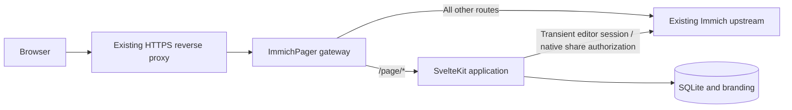

# Architecture

## Request flow

One Node process serves the application and proxies Immich. Immich's database, image, originals, and configuration are not modified. Only Pager-owned shared links are created, updated, or deleted through Immich's HTTP API.

## Code boundaries

- `src/lib/contracts.ts`: validated inputs, typed domain records, public/editor DTOs.
- `src/lib/server`: SQLite persistence, Immich HTTP client, authorization, page lifecycle, public gallery assembly.
- `src/lib/components`: reusable public gallery presentation.
- `src/routes`: thin HTTP adapters and editor/client screens, all mounted under `/page`.
- `server`: same-origin gateway and credential-free sidebar bridge.
- `fixtures`, `tests`, `e2e`: local Immich fixture, domain/integration tests, production-browser tests.

## Authentication and ownership

The editor forwards the current browser's Immich session to `GET /api/users/me`. Pager then verifies the returned user ID against each stored page's owner. Browser-supplied owner IDs are never accepted. Only owned albums can be selected. The Immich client normalizes v3 ownership from `albumUsers[0].user.id` (the upstream DTO guarantees the owner is first), with `ownerId` retained as a legacy fallback. Shared-with-me collaborators never become owners. HTTP fixtures use the v3 DTO so client/schema drift cannot silently empty the picker. No global API key or persistent editor credentials are needed.

Public page passwords use salted scrypt hashes. Unlocking obtains native shared-link authorization using the submitted password and retains only the resulting cookie capabilities in a 12-hour server-side session. The browser receives an opaque, HttpOnly, SameSite cookie scoped to `/page`. Passwords are never persisted by Pager; Immich manages the native links according to its own implementation.

Metadata and all image routes independently enforce publication and session checks. Owner previews require a freshly verified Immich session. Page revisions invalidate client sessions after settings or membership changes. Native album links are independent of the overview: Immich can prompt again, and previously authorized native sessions follow Immich's lifecycle.

## Durable sharing operations

Draft saves do not publish albums. Publishing creates one dedicated native link per page–album association, with deterministic custom slugs `pager-{page UUID}-{album UUID}`. Their custom URLs open the native viewer; the branded overview uses `/page/{client slug}`.

Before changing links, persist `syncing` and the operation intent. Persist each successful create or delete. On retry, list the owner's native shares and adopt matching deterministic slugs, recovering creates whose response was lost. Missing links can be recreated. Native updates always include the slug because the reviewed Immich service otherwise clears it.

Errors and interrupted operations hide the public overview. Restart recovery converts `syncing` to `error`; the owner can retry publishing, unpublishing, or deletion with their current session. Removing protected albums or changing passwords hides the overview until synchronization succeeds. Already issued direct native links may remain usable until revocation reaches Immich; Pager does not claim to revoke an upstream link while Immich is offline.

Use exactly one Pager process/container per database. A process-local mutation lock prevents concurrent operations on the same page. SQLite WAL and foreign keys protect local consistency. Scaling multiple replicas against the same volume is unsupported.

## Storage and migrations

SQLite schema version 1 is initialized transactionally in `Store`. Tables hold pages, dedicated links, expiring public sessions, branding images, and password-attempt buckets. Forward migrations must use `PRAGMA user_version` and remain covered by tests. A newer database is refused by an older application. Future migrations must be added sequentially; do not modify the meaning of an existing version.

Branding uploads accept JPEG, PNG, and WebP up to 5 MB / 32 megapixels and are decoded, rotated, resized, stripped of metadata, and re-encoded to WebP. Photo covers are streamed from Immich. Protect the data volume: it contains share capabilities and session authorization, even though it contains no photo originals.

## Integration boundary

The gateway injects a small external sidebar script into eligible uncompressed Immich HTML. The bridge clones the Sharing entry and mounts the editor in a same-origin iframe. If the main layout is unavailable, the link falls back to the standalone editor. This is a maintained DOM integration, not an official Immich plugin API. Native API requests, share pages, binary responses, uploads, and WebSocket upgrades remain upstream.

Initial source review targets Immich v3.3.1. See [validation](validation.md) for the distinction between fixture verification and live compatibility.
