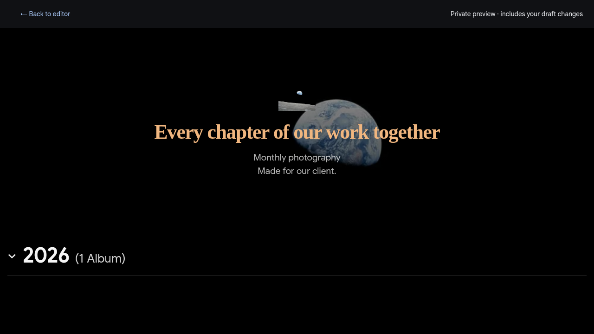

# Customize a client gallery

Open **Pages → your page → Options**. All appearance settings belong to this page. Changes autosave as a private working draft; use **Preview** to check them, then **Publish page** or **Update live page** to show them to clients. Your existing client URL stays the same.

This feature is being developed on the **dev branch**. The current main release and live deployment remain unchanged.

## Colors and accent

Choose Dark, Light, or System under Appearance. Expand **Custom colors** to override background, text, and accent colors. The default accent is Immich blue (`#accbfa`). Currently, accent changes **album-title text on hover**; it does not recolor the page title, banner, management buttons, or native Immich album viewer. CSS can use the same accent for other gallery elements.

## Compose the header over a banner

Add a banner using **Choose from Immich**, an upload, or a file drop. In Options → Appearance, change **Header layout** from **Below banner** to **Over banner**. Your logo, title, and description move together onto the image. Header alignment controls left or centered composition. Banner crop position controls the image's vertical focal point.

Overlay mode uses white text and a dark gradient to keep the header readable. The banner grows to fit longer text on narrow screens. If you remove the banner, the header returns to the normal layout; the saved overlay choice takes effect when you add a banner again. Existing pages default to Below banner.



## Set typography and spacing

In **Options → Appearance**, use the sliders to set title size (1.5–4 rem), description size (0.875–1.5 rem), and header spacing (1.5–5 rem). The title scales with page width, and spacing adjusts on narrow screens. Google Sans remains the default font. Existing and new pages start with a 3 rem title, 1.125 rem description, and 2.5 rem header spacing.

Changes autosave to the private draft and appear in Preview. Your client page changes only after you publish. Existing pages receive defaults without a database migration.

## Add CSS

Expand **Advanced · Custom CSS** in Options. Enter ordinary CSS, close Options, and use Preview. CSS is limited to 20,000 characters. **Clear custom CSS** removes the draft stylesheet; publish that change to reset the live gallery too.

CSS is parsed and limited to this gallery. Selectors cannot change the management UI, preview toolbar, other pages, or native Immich album views. Positioned content is clipped to the gallery boundary, so fixed elements behave relative to the gallery rather than the browser viewport. There is no JavaScript or HTML editor.

Errors include a source location where available. Invalid CSS remains saved in your private draft, but the **entire custom stylesheet is omitted** from preview and publication is blocked until you fix or clear it. The current live page keeps its last published settings. Variables are resolved by the browser; undefined variables or unsupported browser features can still cause individual declarations to be ignored.

Use ordinary rules and selector lists, plus `@media`, `@supports`, and `@container`. Write separate rules instead of nested selectors. External resources are blocked: no `@import`, `@font-face`, `url()`, `image-set()`, `attr()`, or other resource/attribute functions. This also blocks same-origin resource URLs. Other at-rules, including keyframes, are not supported. Existing Immich-selected branding and album covers remain available through the normal controls. Use bundled/system fonts and CSS gradients rather than downloading resources.

Custom styles are emitted after built-in styles, but normal CSS specificity still applies. Built-in component selectors and inline styles can win; use `!important` on a property when you deliberately need to override them. Start with the stable hooks below rather than Svelte's generated classes.

### Stable selectors

Selectors are relative to the gallery. Use `:scope` for the gallery root, **not** `html`, `body`, or `:root`.

| Selector                        | Element                           |
| ------------------------------- | --------------------------------- |
| `:scope` / `.ip-gallery`        | Gallery root and theme variables  |
| `.ip-hero`                      | Banner/header composition         |
| `.ip-banner` / `.ip-banner img` | Banner area / image               |
| `.ip-header`                    | Logo, title and description       |
| `.ip-logo`                      | Logo image                        |
| `.ip-title`                     | Page title                        |
| `.ip-description`               | Page description                  |
| `.ip-albums`                    | Albums section                    |
| `.ip-year-group`                | Collapsible year group            |
| `.ip-year-heading`              | Year summary and count            |
| `.ip-album-grid`                | Grid within a year                |
| `.ip-album`                     | Album link/card                   |
| `.ip-cover` / `.ip-cover img`   | Square cover area / image         |
| `.ip-album-info`                | Album title, dates and item count |
| `.ip-footer`                    | Project/source attribution        |

The documented hooks and variables are the customization interface. Other classes and generated scope attributes are implementation details.

### Theme variables

Set these on `:scope`. When omitted, the corresponding Options color or selected theme remains in use.

| Variable             | Effect                                                               |
| -------------------- | -------------------------------------------------------------------- |
| `--pager-accent`     | Album-title hover color; can be reused elsewhere                     |
| `--pager-background` | Gallery background                                                   |
| `--pager-foreground` | Gallery text; overlay header uses white unless explicitly overridden |

```css
:scope {
  --pager-accent: #f0b67f;
  --pager-background: #14120f;
  --pager-foreground: #faf5ec;
}

.ip-year-heading {
  color: var(--pager-accent);
}
```

### Title typography

Use installed system fonts, including the gallery's bundled Google Sans, without external font requests.

```css
.ip-title {
  font-family: Georgia, serif;
  letter-spacing: -0.03em !important;
  font-size: clamp(2rem, 4vw, 4rem) !important;
}
```

### Cover corners and grid spacing

```css
.ip-cover {
  border-radius: 6px !important;
}

.ip-album-grid {
  column-gap: 32px !important;
  row-gap: 56px !important;
}
```

### Mobile adjustments

```css
@media (max-width: 600px) {
  .ip-title {
    font-size: 32px !important;
  }

  .ip-album-grid {
    gap: 20px 4px !important;
  }

  .ip-header {
    padding-inline: 20px !important;
  }
}
```

## Contributor implementation notes

`headerLayout`, `titleSize`, `descriptionSize`, `headerSpacing`, and `customCss` (raw CSS text) are additive settings on working drafts, published records, and gallery DTOs. Missing fields in older stored JSON receive defaults on read; the SQLite schema stays at version 2. Draft writes preserve invalid CSS text so an unfinished edit is recoverable. Publication validates the stylesheet before changing any live data or native shares.

The shared compiler uses CSS Tree to parse, validate supported constructs, and add a page-specific guard to each selector's target, including selectors with pseudo-elements. `:scope` maps to the gallery root. A separate, untargetable layout/paint containment wrapper isolates positioned descendants. The renderer only serializes compiled CSS and escapes `<` as a CSS escape before placing it in a style element; raw author text is never inserted as HTML. Existing CSP directives remain unchanged. Browser tests cover style-closing strings, selector escape attempts, containment, private drafts, publication and resetting.

When adding hooks or new CSS syntax support, extend the validation and browser scenarios first. Avoid making generated Svelte classes part of the public interface. See [API contracts](api.md) and [architecture](architecture.md).
